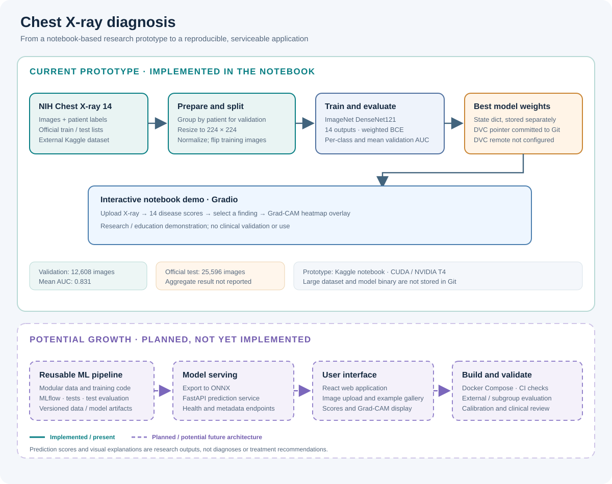

# Chest X-ray Diagnosis

**A research and educational prototype for multi-label chest X-ray classification.**

This project explores using a deep-learning model to estimate the presence of 14 thoracic findings in frontal chest X-rays. It combines an ImageNet-pretrained DenseNet121, patient-aware validation, class-weighted binary cross-entropy, and Grad-CAM visualizations. The current implementation lives in a Kaggle notebook; the API, web frontend, and deployment architecture below are potential next steps, not completed production components.

> **Research use only — not a medical device.** The model is not validated or intended to diagnose, screen, triage, or guide treatment. Its predictions and visualizations must not be used for clinical decisions.

## Architecture and growth plan

The diagram distinguishes notebook functionality that already exists from the proposed path toward a deployable application. **Solid outlines** show the current prototype; **dashed outlines** show potential future work.



| Status | Component |
| --- | --- |
| **Implemented in notebook** | Dataset loading, patient-grouped train/validation split, image preprocessing, DenseNet121 training and validation, checkpointing, Grad-CAM, and an interactive Gradio demo. |
| **Available as a model reference** | A DVC pointer for `best_model.pth`; the weight file itself is downloaded separately. |
| **Planned** | Reusable source pipeline, experiment tracking, formal held-out test evaluation, ONNX export, FastAPI backend, React frontend, containerization, and automated checks. |

## Project goals

- Train one model to produce independent scores for multiple findings in each image.
- Compare validation performance using per-class and macro-mean area under the ROC curve (AUC).
- Explore class-imbalance handling and patient-aware evaluation.
- Demonstrate image-region explanations using Grad-CAM and an interactive notebook demo.
- Provide a foundation for future reproducible experiments and an optional web application.

## Dataset and labels

The experiments use [NIH Chest X-ray 14](https://www.kaggle.com/datasets/nih-chest-xrays/data), a dataset of **112,120 frontal X-rays from 30,805 patients** (approximately **45 GB**). The images and dataset metadata are not included in this Git repository; access and use are subject to the dataset's terms.

The model predicts 14 findings:

> Atelectasis · Cardiomegaly · Effusion · Infiltration · Mass · Nodule · Pneumonia · Pneumothorax · Consolidation · Edema · Emphysema · Fibrosis · Pleural Thickening · Hernia

“No Finding” is represented by an all-zero disease-label vector, rather than an additional model output.

### Splits and leakage prevention

- The official `train_val_list.txt` pool contains **86,524** images; `test_list.txt` contains **25,596**.
- A 15% validation subset is held out from the official training/validation pool using `GroupShuffleSplit` on `Patient ID` with `random_state=42`. Grouping by patient keeps a patient's images from being split between training and validation.
- The official test split is separate from training and validation. **A formal aggregate test-set result has not yet been reported.**

## Model and training

| Setting | Current notebook configuration |
| --- | --- |
| Backbone | `torchvision.models.densenet121`, initialized with ImageNet weights |
| Classifier | Replaced with a `Linear(1024, 14)` output layer |
| Fine-tuning | Full network |
| Input preprocessing | Resize to 224 × 224; ImageNet channel normalization |
| Training augmentation | Random horizontal flip |
| Loss | `BCEWithLogitsLoss` with per-class positive weights |
| Optimizer | Adam, learning rate `1e-4` |
| Training loop | Up to 15 epochs, with the best validation-mean-AUC checkpoint saved |
| Evaluation | Per-class ROC AUC and the mean across the 14 disease labels |
| Explainability / demo | Grad-CAM overlays and a Gradio image-upload interface in the notebook |

### Validation result

| Model | Evaluation split | Images | Mean AUC across 14 classes |
| --- | --- | ---: | ---: |
| ImageNet-initialized DenseNet121, full fine-tuning, class-weighted BCE | Patient-grouped validation | 12,608 | **0.831** |
| Same model | Official held-out test | 25,596 | Not yet reported |

The validation result is an experimental metric, not evidence of clinical readiness. The held-out test evaluation, external validation, calibration, subgroup analysis, and baseline/ablation studies remain open work.

## Try the prototype

The executable prototype is [`notebooks/chest-xray-diagnosis.ipynb`](notebooks/chest-xray-diagnosis.ipynb). It was developed as a Kaggle notebook with GPU access (NVIDIA T4), using the NIH dataset as a Kaggle input. The notebook contains the data preparation, training, validation, model-loading, Grad-CAM, and Gradio demo sections.

- [Open the Kaggle notebook](https://www.kaggle.com/code/haydermethneni/chest-xray-diagnosis) (availability depends on Kaggle account access).
- Attach the NIH Chest X-ray 14 dataset as a notebook input before running the data-loading cells.
- The notebook includes its own package-install cells for the Grad-CAM and Gradio demos. Its training and inference code expects a CUDA-enabled Kaggle runtime; this repository does not yet provide a ready-to-run local setup or dependency lockfile.

## Model weights

Git stores [`models/best_model.pth.dvc`](models/best_model.pth.dvc), a DVC pointer—not the approximately 28 MB model weight file. The README, notebook, and DVC pointer can therefore be cloned without downloading model binaries.

There is **no DVC storage remote configured** yet, so `dvc pull` cannot retrieve the weight artifact from this repository. If you have access to the private Kaggle model and have configured the Kaggle CLI, the notebook's documented download command is:

```bash
python -m kaggle models instances versions download \
  haydermethneni/best-model/pytorch/default/1 \
  -p models --untar
```

The resulting `best_model.pth` is a PyTorch `state_dict` for DenseNet121 with a 14-output classifier. Model weights and dataset files are ignored by Git; do not commit them directly.

## Repository layout

```text
.
├── docs/
│   └── architecture-growth.svg       # Current architecture and potential growth
├── models/
│   └── best_model.pth.dvc            # DVC metadata; not the weight file
├── notebooks/
│   ├── chest-xray-diagnosis.ipynb    # End-to-end Kaggle prototype
│   └── kernel-metadata.json          # Kaggle notebook configuration
├── .dvc/                             # DVC project configuration
└── README.md
```

## Roadmap

- [x] Select the project topic and dataset; initialize Git and DVC metadata.
- [x] Build a notebook prototype with patient-grouped validation and a DenseNet121 classifier.
- [x] Report validation mean AUC and demonstrate Grad-CAM with a notebook Gradio interface.
- [ ] Configure a DVC remote for reproducible model-artifact retrieval.
- [ ] Move data, model, training, and evaluation logic into a reusable `src/` pipeline.
- [ ] Add MLflow experiment tracking and a repeatable evaluation workflow.
- [ ] Report held-out test metrics; add a baseline and augmentation/loss ablation studies.
- [ ] Export the validated model to ONNX and build a FastAPI prediction/visualization service.
- [ ] Build a React interface for image upload, prediction scores, and Grad-CAM overlays.
- [ ] Add Docker Compose, automated lint/tests/builds, and the technical report.

## Team and context
- Hayder Methneni

## References

- [NIH Chest X-ray 14 dataset on Kaggle](https://www.kaggle.com/datasets/nih-chest-xrays/data)
- [Kaggle prototype notebook](https://www.kaggle.com/code/haydermethneni/chest-xray-diagnosis)
- [DVC documentation](https://dvc.org/doc)
